# Nature-inspired software architectures

An evidence-linked catalogue of biological organisation translated into software design patterns, with diagrams, small Python implementations and example use cases.



The starting question: **What architectures has evolution produced for coordinating complexity at molecular, cellular, organism and population scales—and which mechanisms are useful in software?**

The catalogue separates biological observations, explanations for how they evolved, and engineering hypotheses. A useful analogy is a starting point for a test, not evidence that a software design is optimal. See the [research map](docs/research-map.md) and [methodology](docs/methodology.md).

## Pattern catalogue

| Pattern | Biological connection | Software problem | Example |
| --- | --- | --- | --- |
| [Bounded compartments](patterns/01-compartments.md) | Functional modules and compartmentalisation | Contain overload and expected failures | Billing continues while analytics rejects work |
| [Bow-tie canonical core](patterns/02-bow-tie.md) | Diverse metabolic inputs and outputs around a shared core | Reduce pairwise integrations | Two sensor formats feed independent consumers |
| [Integral feedback](patterns/03-feedback.md) | Adaptation in cellular signalling | Regulate a service under changing demand | Capacity tracks a utilisation target |
| [Persistence filter](patterns/04-persistence.md) | Coherent feed-forward regulatory motif | Ignore transient activation signals | Sustained load activates an action |
| [Conserved capabilities](patterns/05-development.md) | Facilitated variation in development | Add variants without duplicating core logic | Two document workflows share processing stages |
| [Diverse fallbacks](patterns/06-degeneracy.md) | Biological degeneracy | Retain a minimum function after failure | A simpler route solver replaces an unavailable optimiser |
| [Local worker activation](patterns/07-swarm.md) | Harvester-ant encounters and departures | Adapt activity using local information | Success contacts stimulate simulated workers |
| [Quorum signalling](patterns/08-quorum.md) | Bacterial chemical communication | Coordinate optional activity with local participation | A decaying signal field gates local activation |

Every entry contains the biological basis and citations, a mapping table, an architecture diagram in SVG and editable Mermaid, implementation notes, use cases, failure modes, limits of the analogy, and an experiment to try.

## Run the examples

Python 3.11 or newer. The examples and tests use only the standard library. No installation, credentials, services or network access are required after cloning.

```sh
git clone https://github.com/timini/nature-inspired-architectures.git
cd nature-inspired-architectures
python3 -m natural_architectures all
python3 -m natural_architectures feedback
python3 -m unittest discover -s tests -v
python3 scripts/check_docs.py
```

The command prints JSON. [Captured example output](examples/output.json) shows a complete run. The stochastic examples use fixed seeds; tests check behavioural properties across additional seeds rather than requiring identical output on every Python version.

These are executable reference examples and simulations, not production infrastructure. In particular, bounded queues do not isolate processes, and quorum signalling does not implement consensus. Each pattern documents what must change for a real deployment.

## One example: diverse fallback

```python
from natural_architectures.degeneracy import route, fewest_hops

graph = {
    "a": {"b": 1, "d": 10},
    "b": {"c": 1},
    "c": {"d": 1},
    "d": {},
}
print(route(graph, "a", "d"))
# {'solver': 'weighted_route', 'path': ['a', 'b', 'c', 'd'], 'cost': 3}

print(route(graph, "a", "d", (fewest_hops,)))
# {'solver': 'fewest_hops', 'path': ['a', 'd'], 'cost': 10}
```

The shared contract is a valid route. The fallback has a different implementation and visibly lower quality. [The complete pattern](patterns/06-degeneracy.md) explains why this is useful and when it would violate the application’s requirements.

## Research and references

- [Research map](docs/research-map.md): scales, foundational questions and further directions.
- [Annotated bibliography](references/README.md): all 19 biological, conceptual and project sources, including those from the initial discussion.
- [BibTeX](references/references.bib): stable citation keys for reference managers.
- [Reference metadata](references/metadata.json): machine-readable titles, authors, dates, DOI links, evidence types and relevance notes.
- [Methodology](docs/methodology.md): how to distinguish evidence, analogy and a software claim.
- [Contribution guide](CONTRIBUTING.md): how to add a researched, runnable pattern.

A useful reading order is Simon’s [architecture of complexity](references/README.md#simon1962), Csete and Doyle’s [biology-engineering comparison](references/README.md#csete2002), and Gerhart and Kirschner’s [facilitated variation](references/README.md#gerhart2007).

## Repository layout

```text
patterns/                 Pattern explanations and diagrams embedded in context
natural_architectures/    Dependency-free Python reference implementations
tests/                    Behavioural tests, failure injection and invariant checks
diagrams/                 Editable Mermaid sources and rendered SVGs
references/               Annotated bibliography, BibTeX and metadata
docs/                     Research map and methodology
examples/output.json      Captured example run
catalogue.json            Machine-readable pattern index
scripts/                  Documentation checks and optional diagram rendering
tools/diagrams/           Optional, pinned diagram-rendering tooling
```

GitHub Actions runs the examples, tests and documentation checks on Python 3.11–3.14. [Diagram instructions](diagrams/README.md) explain how to regenerate the committed SVGs.
