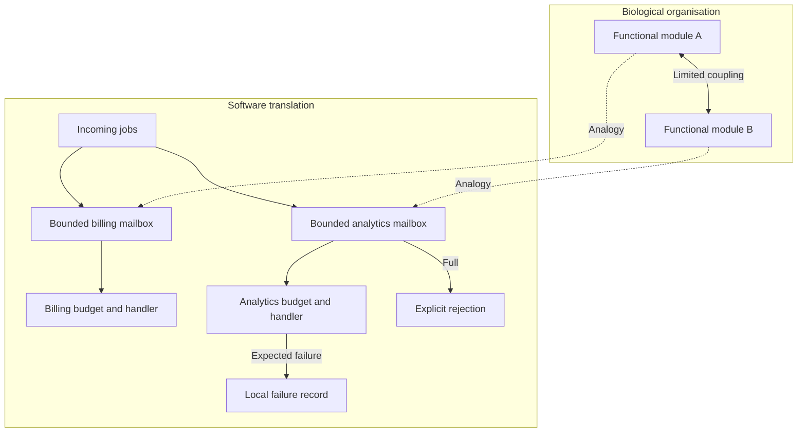

# Bounded compartments

[Catalogue](../README.md) · Scale: Molecular modules, cells and ecological networks

## Biological basis and evidence

Many biological processes operate in functional modules. Simon describes nearly decomposable systems; Hartwell and colleagues identify cellular functions carried out by interacting molecular groups. Stouffer and Bascompte study compartmentalisation in food-web models. These are related organisational ideas at different scales, not one identical mechanism.

Sources: [simon1962](../references/README.md#simon1962), [hartwell1999](../references/README.md#hartwell1999), [stouffer2011](../references/README.md#stouffer2011), [kitano2004](../references/README.md#kitano2004). These sources support the biological or conceptual basis; they do not validate this software implementation.

## Problem

An overloaded or failing optional workload consumes resources needed by an unrelated critical workload.

## Translation into a software pattern

| Biological concept | Software interpretation |
| --- | --- |
| Functional module | A component owning its mailbox and processing policy |
| Relatively limited coupling | Explicit message submission with admission control |
| Local disturbance | A rejected or failed job kept within that component |

Give each component a bounded mailbox and an independent execution budget. Reject excess work at admission. Catch only expected domain failures at the component boundary, record them, and allow healthy components to proceed. Keep interfaces small enough that internal changes need not propagate.

## Architecture diagram



The dotted edges indicate an analogy, not a biological causal relationship. [Editable Mermaid source](../diagrams/compartments.mmd).

<details>
<summary>Mermaid diagram</summary>



</details>

## Reference implementation

[compartments.py](../natural_architectures/compartments.py)

`Compartment.submit` returns an explicit rejection when the queue is full. `tick` handles at most one job and records `RejectedJob` failures. The example overloads analytics and injects a bad analytics job while billing still completes.

```sh
python3 -m natural_architectures compartments
```

Expected behaviour: Billing produces `INVOICE`; analytics produces `REPORT`, records `bad`, and rejects one overflow job.

The [captured example output](../examples/output.json) contains an actual run. These are small executable teaching examples, not production libraries or validated biological simulators.

## Example use cases

- Separate billing from optional analytics so report bursts cannot fill the billing queue.
- Give each tenant a mailbox and quota in a document-processing service.
- Separate telemetry collection from a device control loop.

## Trade-offs and failure modes

Isolation leaves some capacity idle and introduces queues and cross-boundary protocols. Shared databases, locks or thread pools can still couple failures. A slow or stuck handler blocks this single-threaded example; actual execution isolation requires processes, timeouts and independently provisioned resources. Completion and failure lists are unbounded audit traces for the demo.

## Where the analogy stops

The example demonstrates queue admission and expected-failure isolation. It does not demonstrate process, memory, network or security isolation. Biological modules can have substantial cross-talk; compartmentalisation is not proof of complete independence.

## Validation and experiment to try

Run the behavioural tests from the repository root:

```sh
python3 -m unittest discover -s tests -p test_patterns.py -k CompartmentTests -v
```

Compare a shared queue with separate queues under the same total capacity. Measure critical-workload p95 latency, rejection rate and throughput during an optional-workload flood.
