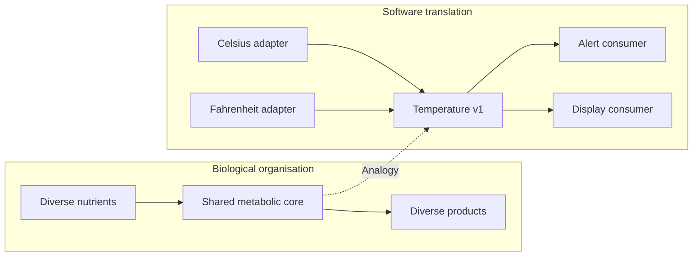

# Bow-tie canonical core

[Catalogue](../README.md) · Scale: Cellular metabolism and information flow

## Biological basis and evidence

Bow-tie descriptions of metabolism identify many inputs and outputs connected through a smaller shared set of intermediate processes and carriers. Csete and Doyle use this organisation to discuss flexibility and robustness, as well as the vulnerabilities created by dependence on the core.

Sources: [csete2004](../references/README.md#csete2004), [csete2002](../references/README.md#csete2002). These sources support the biological or conceptual basis; they do not validate this software implementation.

## Problem

Every new input format requires changes to every consumer, creating a growing set of pairwise integrations.

## Translation into a software pattern

| Biological concept | Software interpretation |
| --- | --- |
| Diverse biological inputs | Vendor-specific input adapters |
| Shared intermediate core | A small, versioned canonical event |
| Diverse biological outputs | Independent consumers of that event |

Normalise input at the boundary into an immutable domain event. Downstream consumers depend only on this contract. With M inputs and N outputs, the idealised adapter count becomes M + N instead of M × N; semantic mismatches and exceptional fields can reduce this benefit.

## Architecture diagram



The dotted edges indicate an analogy, not a biological causal relationship. [Editable Mermaid source](../diagrams/bow_tie.mmd).

<details>
<summary>Mermaid diagram</summary>



</details>

## Reference implementation

[bow_tie.py](../natural_architectures/bow_tie.py)

Two adapters convert Celsius and Fahrenheit payloads to `Temperature(version=1)`. The core validates sensor identity, schema version and finite values. Alerting and display independently consume the same event.

```sh
python3 -m natural_architectures bow_tie
```

Expected behaviour: 35 Celsius and 95 Fahrenheit both become 35 Celsius and produce equivalent overheating decisions.

The [captured example output](../examples/output.json) contains an actual run. These are small executable teaching examples, not production libraries or validated biological simulators.

## Example use cases

- Unify telemetry from several hardware vendors before alerting and storage.
- Compile multiple source languages into a common intermediate representation.
- Translate several partner order formats into a stable internal order model.

## Trade-offs and failure modes

A poorly chosen core loses information or grows into a schema that serves nobody well. Changes require versioning and migration. A shared contract need not imply a single central server, but bugs in shared semantics can affect all consumers.

## Where the analogy stops

Biochemical intermediates are physical entities with energy and material constraints. A canonical event captures the many-to-few-to-many topology, not metabolic chemistry or a claim that all biological networks are bow ties.

## Validation and experiment to try

Run the behavioural tests from the repository root:

```sh
python3 -m unittest discover -s tests -p test_patterns.py -k BowTieTests -v
```

Add a third input format and record how many existing consumers change. Also measure loss of source-specific information, schema migration effort and the impact of invalid core data.
