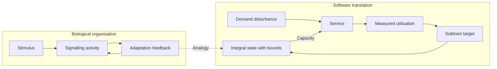

# Integral feedback regulation

[Catalogue](../README.md) · Scale: Cellular signalling and physiological control

## Biological basis and evidence

Bacterial chemotaxis can restore signalling activity after a sustained change in stimulus. Yi and colleagues analyse integral feedback as a mechanism for robust adaptation under specified conditions. The system uses accumulated error to influence subsequent response.

Sources: [yi2000](../references/README.md#yi2000), [kitano2004](../references/README.md#kitano2004). These sources support the biological or conceptual basis; they do not validate this software implementation.

## Problem

A fixed resource allocation leaves a service underused at low demand and overloaded after a demand increase.

## Translation into a software pattern

| Biological concept | Software interpretation |
| --- | --- |
| Regulated biological activity | Measured service utilisation |
| Adaptation reference | Target utilisation |
| Integral feedback state | Accumulated adjustment to capacity |

Measure utilisation, subtract the target, and integrate the error into an actuator setting: `capacity_next = clamp(capacity + gain × (utilisation − target))`. Positive error increases capacity. Clamp the integral state itself to avoid hidden accumulation beyond actuator limits. Sampling intervals are fixed in this example.

## Architecture diagram


The dotted edges indicate an analogy, not a biological causal relationship. [Editable Mermaid source](../diagrams/feedback.mmd).

<details>
<summary>Mermaid diagram</summary>



</details>

## Reference implementation

[feedback.py](../natural_architectures/feedback.py)

A deterministic plant uses `utilisation = demand / capacity`. Demand changes from 3 to 7 at tick 60. The controller targets 0.7 utilisation with capacity between 1 and 20. The measurement may exceed one to represent offered load exceeding service capacity.

```sh
python3 -m natural_architectures feedback
```

Expected behaviour: After the step, capacity settles near 10 and utilisation returns near 0.7. The output includes measurements before, during and after the disturbance.

The [captured example output](../examples/output.json) contains an actual run. These are small executable teaching examples, not production libraries or validated biological simulators.

## Example use cases

- Regulate a worker pool toward a chosen utilisation target.
- Adjust background ingestion intensity to retain headroom.
- Adapt concurrency in a batch processor when the plant response has been measured.

## Trade-offs and failure modes

Delay, noise, discrete instance counts and excessive gain can cause oscillation. Hard capacity limits can make the target unreachable. Our plant has instantaneous response and no queue; it is deliberately easier to control than a real autoscaler. A fixed gain is not safe across arbitrary plants.

## Where the analogy stops

This is a software integral controller inspired by a biological control analysis. It does not reproduce the molecular chemotaxis pathway, prove stability for a real service, or establish perfect adaptation under arbitrary disturbances.

## Validation and experiment to try

Run the behavioural tests from the repository root:

```sh
python3 -m unittest discover -s tests -p test_patterns.py -k FeedbackTests -v
```

Compare against fixed capacity and proportional-only control. Measure steady-state error, overshoot, settling time, saturation duration and operating cost; repeat with measurement noise and startup delay.
