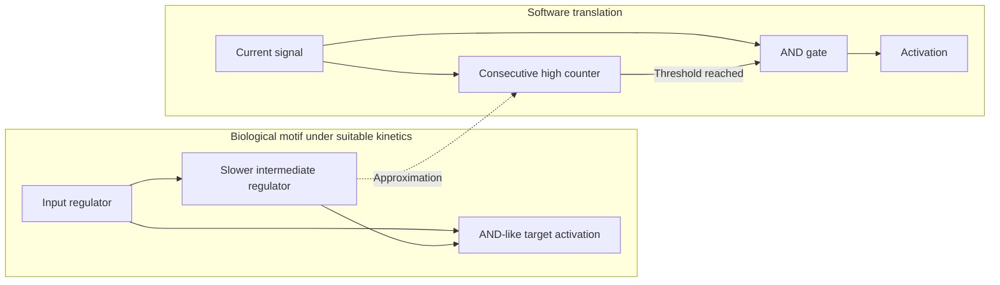

# Coherent feed-forward persistence filter

[Catalogue](../README.md) · Scale: Molecular gene-regulatory networks

## Biological basis and evidence

A coherent feed-forward loop can activate a target through both a direct branch and a slower indirect branch. Under suitable AND-like integration and kinetic conditions, activation requires a persistent input. Alon describes this behaviour alongside other experimentally studied network motifs.

Sources: [alon2007](../references/README.md#alon2007). These sources support the biological or conceptual basis; they do not validate this software implementation.

## Problem

Brief high readings trigger expensive actions even though the underlying condition disappears immediately.

## Translation into a software pattern

| Biological concept | Software interpretation |
| --- | --- |
| Direct activation branch | Current boolean signal |
| Slower indirect branch | A consecutive-sample counter |
| AND integration at the target | Current signal must be high and the delay threshold met |

Activate only after N consecutive high samples. Reset the counter and deactivate immediately when the signal is low. This intentionally gives slow activation and fast deactivation. The counter is bounded, so sustained high input does not grow state indefinitely.

## Architecture diagram



The dotted edges indicate an analogy, not a biological causal relationship. [Editable Mermaid source](../diagrams/persistence.mmd).

<details>
<summary>Mermaid diagram</summary>



</details>

## Reference implementation

[persistence.py](../natural_architectures/persistence.py)

`PersistenceGate(3)` implements the direct-and-delayed condition with a counter. The demo contains an isolated high pulse, then sustained high input, then a low sample. An exhaustive test checks all seven-sample boolean sequences against the persistence property.

```sh
python3 -m natural_architectures persistence
```

Expected behaviour: The isolated pulse is ignored; the third consecutive high activates the gate; the next low sample immediately switches it off.

The [captured example output](../examples/output.json) contains an actual run. These are small executable teaching examples, not production libraries or validated biological simulators.

## Example use cases

- Start extra capacity only after several sustained high-load readings.
- Trigger a noncritical monitoring alert after a persistent condition.
- Debounce an intermittent sensor before starting an expensive batch action.

## Trade-offs and failure modes

Filtering introduces detection delay and can suppress real short events. Samples are assumed equally spaced; N samples do not imply a fixed time interval if sampling drifts. Missing samples, restart state and hysteresis require explicit policies.

## Where the analogy stops

Topology alone does not determine a biological motif’s function. The counter is a digital approximation of delayed activation, not a model of concentrations or regulatory kinetics. This pattern is inappropriate when every transient event must be acted upon.

## Validation and experiment to try

Run the behavioural tests from the repository root:

```sh
python3 -m unittest discover -s tests -p test_patterns.py -k PersistenceTests -v
```

Inject spikes and sustained events. Measure false-trigger rate, missed-event rate and detection delay as N varies. Decide which transient events are acceptable to ignore.
