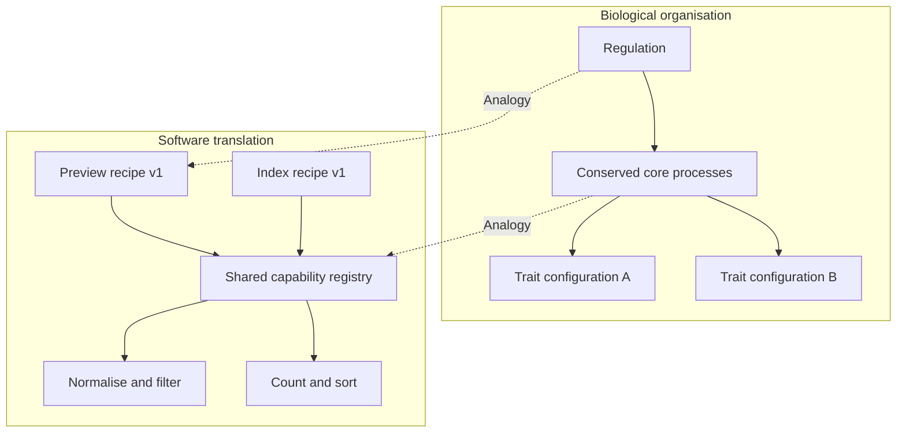

# Conserved capabilities with changeable regulation

[Catalogue](../README.md) · Scale: Organism development and evolutionary change

## Biological basis and evidence

Facilitated variation proposes that conserved core processes can support new traits when regulation changes their usage, timing, location or combination. Separately, Kashtan and Alon show modular structures emerging under modularly changing goals in computational evolution experiments.

Sources: [gerhart2007](../references/README.md#gerhart2007), [kashtan2005](../references/README.md#kashtan2005). These sources support the biological or conceptual basis; they do not validate this software implementation.

## Problem

Every new product variation duplicates processing logic, so fixes and improvements must be repeated across many versions.

## Translation into a software pattern

| Biological concept | Software interpretation |
| --- | --- |
| Conserved core processes | Stable processing capabilities with explicit contracts |
| Regulatory changes | Versioned recipes selecting and ordering capabilities |
| Different resulting traits | Different outputs produced from the same capabilities |

Separate reusable mechanisms from the specification that selects them. Make inputs immutable, validate referenced capabilities before execution, and track derived data so transformations cannot silently leave stale values. A recipe is itself versioned data that can be reviewed and tested.

## Architecture diagram



The dotted edges indicate an analogy, not a biological causal relationship. [Editable Mermaid source](../diagrams/development.mmd).

<details>
<summary>Mermaid diagram</summary>



</details>

## Reference implementation

[development.py](../natural_architectures/development.py)

Four pure stages normalise text, remove empty documents, count words and order documents by length. Two immutable recipes combine them differently. Normalisation invalidates previous word counts; sorting requires counts. The original document values remain unchanged.

```sh
python3 -m natural_architectures development
```

Expected behaviour: `preview-v1` returns cleaned documents. `index-v1` also counts words and orders documents longest-first, using the same normalisation and filtering stages.

The [captured example output](../examples/output.json) contains an actual run. These are small executable teaching examples, not production libraries or validated biological simulators.

## Example use cases

- Build preview and search-index workflows from shared document operations.
- Configure product-specific ingestion pipelines from common validation and transformation stages.
- Reuse a stable set of device behaviours across different operating modes.

## Trade-offs and failure modes

A registry can become an unstructured plugin system. Valid stage names do not guarantee a valid order, compatible semantics or safe side effects. This example uses linear plans and runtime prerequisites; a larger system should compile a typed plan, version contracts and manage stage failures explicitly.

## Where the analogy stops

The implementation demonstrates recombination of capabilities, not morphogenesis, evolutionary search, self-repair or the full theory of facilitated variation. Recipe authors choose the changes; natural selection is absent.

## Validation and experiment to try

Run the behavioural tests from the repository root:

```sh
python3 -m unittest discover -s tests -p test_patterns.py -k DevelopmentTests -v
```

Introduce a new workflow and count duplicated logic, changed stable components and regressions in existing recipes. Compare against independently implemented workflows and record the cost of recipe validation.
