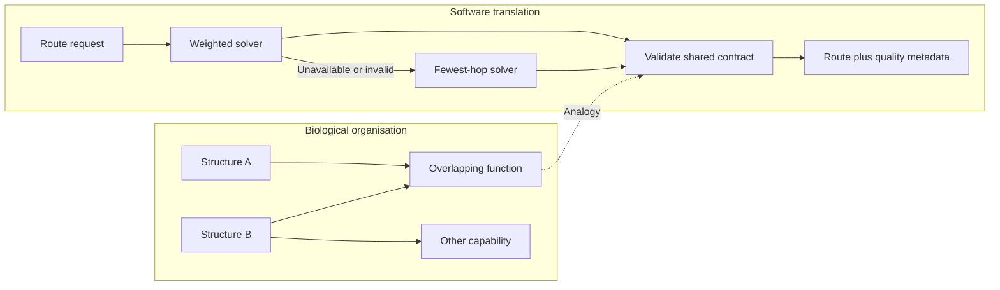

# Diverse implementations with an overlapping contract

[Catalogue](../README.md) · Scale: Molecular, cellular and organism functions

## Biological basis and evidence

Edelman and Gally use degeneracy to describe structurally different elements that can produce the same output or perform the same function in some conditions, while differing in other conditions. This creates overlapping capability without requiring identical parts.

Sources: [edelman2001](../references/README.md#edelman2001), [kitano2004](../references/README.md#kitano2004). These sources support the biological or conceptual basis; they do not validate this software implementation.

## Problem

Replicating one implementation improves availability but preserves its algorithmic weaknesses and shared failure modes.

## Translation into a software pattern

| Biological concept | Software interpretation |
| --- | --- |
| Structurally different elements | Different algorithms or independently implemented services |
| Overlapping function | A minimum result contract shared by every implementation |
| Different additional capabilities | Different quality, cost or performance characteristics |

Specify the minimum acceptable result independently of the preferred implementation. Try diverse implementations and validate each result against that contract. Make reduced quality visible to consumers rather than silently claiming equivalent optimality.

## Architecture diagram



The dotted edges indicate an analogy, not a biological causal relationship. [Editable Mermaid source](../diagrams/degeneracy.mmd).

<details>
<summary>Mermaid diagram</summary>



</details>

## Reference implementation

[degeneracy.py](../natural_architectures/degeneracy.py)

Dijkstra finds a minimum-weight route; breadth-first search finds a route with fewest hops. Both satisfy the shared contract of a connected route between the requested endpoints. The wrapper validates graph weights and result connectivity, skips unavailable solvers, and reports solver identity and cost.

```sh
python3 -m natural_architectures degeneracy
```

Expected behaviour: Normal operation finds a route costing 3. When the preferred solver is unavailable, the fallback returns a valid route costing 10. Availability is preserved at a visible quality cost.

The [captured example output](../examples/output.json) contains an actual run. These are small executable teaching examples, not production libraries or validated biological simulators.

## Example use cases

- Use a simpler routing algorithm when an optimising service is unavailable.
- Fall back from a ranked search engine to basic keyword retrieval.
- Provide a basic local forecast when an advanced remote model cannot run, with quality labelled.

## Trade-offs and failure modes

Implementations may share data corruption, infrastructure failure or the same mistaken contract. Sequential fallbacks can increase latency; the demo has no timeout and cannot recover from a hanging solver. Validation here checks route feasibility, not optimality.

## Where the analogy stops

Diverse software fallbacks illustrate functional overlap but do not establish statistically independent failures or biological evolvability. The example must not be used when minimum cost is a hard correctness requirement.

## Validation and experiment to try

Run the behavioural tests from the repository root:

```sh
python3 -m unittest discover -s tests -p test_patterns.py -k DegeneracyTests -v
```

Inject algorithm-specific and shared-data failures. Measure availability, fallback latency, quality loss and correlated failures against identical replication under an equal resource budget.
