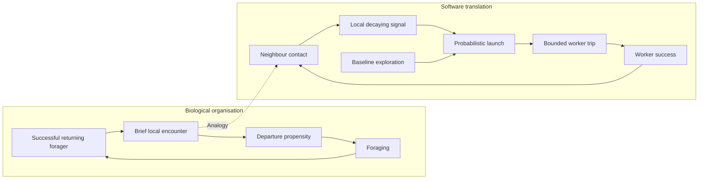

# Local success feedback for worker activation

[Catalogue](../README.md) · Scale: Colonies and collective behaviour

## Biological basis and evidence

Harvester ants can regulate outgoing foragers using brief encounters with successful returning foragers. Prabhakar and colleagues combine field experiments with a stochastic model. Gordon emphasises that collective rules operate within specific ecological conditions and costs.

Sources: [prabhakar2012](../references/README.md#prabhakar2012), [gordon2016](../references/README.md#gordon2016), [abelson2000](../references/README.md#abelson2000). These sources support the biological or conceptual basis; they do not validate this software implementation.

## Problem

Workers need to adjust activity as opportunities change without each worker reading a complete, continuously updated global workload model.

## Translation into a software pattern

| Biological concept | Software interpretation |
| --- | --- |
| Returning forager encounter | Local success notification |
| Departure decision | A worker’s probabilistic decision to start work |
| Limited encounters and fading influence | Bounded local signal with decay and baseline exploration |

Let a worker’s recent success contacts affect its probability of taking work. Allow signals to decay when success stops. Retain a small baseline exploration rate so that an inactive group can discover new opportunities. Keep physical or operational resource limits separate from the activation heuristic.

## Architecture diagram



The dotted edges indicate an analogy, not a biological causal relationship. [Editable Mermaid source](../diagrams/swarm.mmd).

<details>
<summary>Mermaid diagram</summary>



</details>

## Reference implementation

[swarm.py](../natural_architectures/swarm.py)

Twenty simulated workers use only local signal state. Each successful return contacts another worker; contacts are delivered after the current tick. A trip expires after eight ticks. A seeded environment generates successes, while workers do not inspect its success probability. The simulation loop advances time and delivers contacts.

```sh
python3 -m natural_architectures swarm
```

Expected behaviour: For the bundled seed, abundant opportunities produce more departures and completions than scarce opportunities. With no success, low-rate exploration continues. Tests compare ten seeds and verify finite worker occupancy.

The [captured example output](../examples/output.json) contains an actual run. These are small executable teaching examples, not production libraries or validated biological simulators.

## Example use cases

- Explore task sources in a distributed crawler when successful work indicates further opportunities.
- Activate opportunistic edge-processing workers through neighbour success messages.
- Prototype local task-allocation heuristics in a multi-agent simulation.

## Trade-offs and failure modes

Positive feedback can amplify misleading success or overload a downstream resource. Contacts can be delayed, lost or forged in a real network. This model has a fixed population and no task identities, durable queue, fair allocation, backpressure or delivery guarantees.

## Where the analogy stops

This is an illustrative local-feedback simulation, not a reproduction of the paper’s fitted algorithm or a distributed worker service. Encounter delivery and time are simulated centrally; workers’ decisions use local state. No optimality or general scalability claim follows.

## Validation and experiment to try

Run the behavioural tests from the repository root:

```sh
python3 -m unittest discover -s tests -p test_patterns.py -k SwarmTests -v
```

Compare local activation against fixed-rate and central scheduling under equal worker limits. Vary opportunity density, message loss and signal delay; record throughput, wasted work, fairness and overload.
