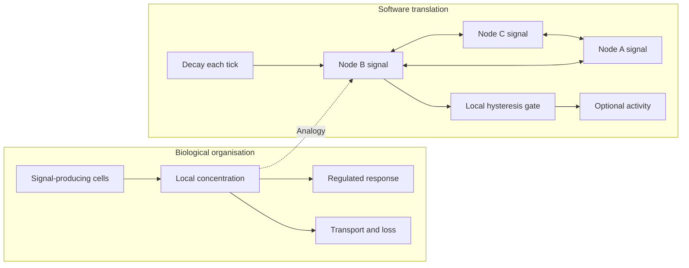

# Local quorum signalling with decay

[Catalogue](../README.md) · Scale: Bacterial populations and collective regulation

## Biological basis and evidence

Bacteria can release and detect signalling molecules, regulating behaviour in response to their local chemical environment. Waters and Bassler describe quorum-sensing architectures. Concentration reflects production, transport and loss, so it cannot generally be interpreted as an exact population count.

Sources: [waters2005](../references/README.md#waters2005), [abelson2000](../references/README.md#abelson2000). These sources support the biological or conceptual basis; they do not validate this software implementation.

## Problem

An expensive local group activity should start only when enough nearby participation is sustained, and should stop after participants disappear.

## Translation into a software pattern

| Biological concept | Software interpretation |
| --- | --- |
| Signal production | Periodic emission by participating nodes |
| Diffusion and degradation | Neighbour mixing and signal decay |
| Regulated collective response | Local threshold gate with separate activation and deactivation levels |

Maintain a local signal estimate at each node. Mix it with neighbouring estimates and decay old signal. Activate at an upper threshold and deactivate at a lower threshold to reduce switching. Hysteresis is an engineering choice here, not asserted as a property of every biological quorum system.

## Architecture diagram



The dotted edges indicate an analogy, not a biological causal relationship. [Editable Mermaid source](../diagrams/quorum.mmd).

<details>
<summary>Mermaid diagram</summary>



</details>

## Reference implementation

[quorum.py](../natural_architectures/quorum.py)

A synchronous ring of twelve nodes exchanges only adjacent signal values. Participants emit one unit per tick. A convex neighbour average, 20% decay and thresholds of 2 and 1 govern local state. Every node reads the previous tick, preventing update-order bias.

```sh
python3 -m natural_architectures quorum
```

Expected behaviour: One emitter activates only a local part of the ring; all emitters eventually activate all nodes; after emission stops, every node deactivates as signal decays.

The [captured example output](../examples/output.json) contains an actual run. These are small executable teaching examples, not production libraries or validated biological simulators.

## Example use cases

- Enable optional edge aggregation when nearby participating devices sustain sufficient signal.
- Coordinate noncritical cooperative caching or prefetching.
- Explore density-sensitive activity in spatial agent simulations.

## Trade-offs and failure modes

Nodes may disagree, and activation is delayed by transport and thresholds. Stale, duplicated or malicious emissions distort the signal. The ring, synchrony and numeric concentrations are simplified. Production messages would need identity, expiry and an explicit loss model.

## Where the analogy stops

This is not a voting quorum, membership service or consensus protocol. It provides no single-leader, agreement, transaction or partition-safety guarantee. Use it for optional collective behaviour, never as authority for an irreversible distributed decision.

## Validation and experiment to try

Run the behavioural tests from the repository root:

```sh
python3 -m unittest discover -s tests -p test_patterns.py -k QuorumTests -v
```

Vary node density, topology, signal loss and departure rate. Measure activation latency, disagreement, stale activation and switching frequency. Compare against a central count with expiring membership.
